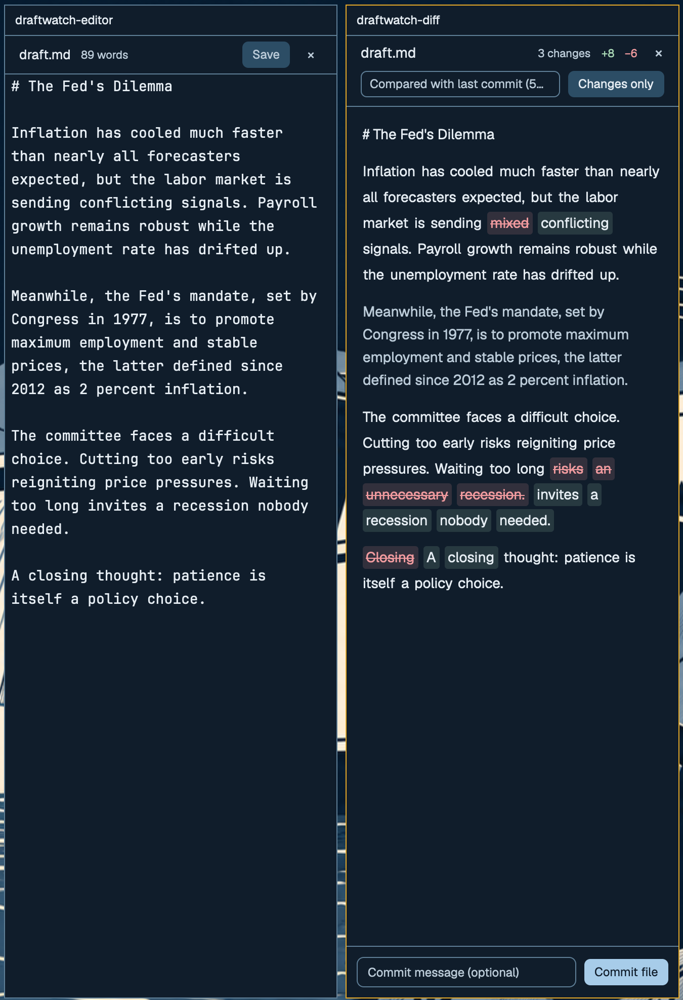

# Draftwatch for Herdr

Watch an AI agent's edits to your writing word by word, inside the [Herdr desktop app](https://github.com/herdrdev/herdr-app).



When an agent edits your prose, a line-level diff tells you a paragraph changed. It does not tell you which words. This mod opens two panes beside the agent:

- **Editor**: the file, for your own typing. Saving never overwrites a version the pane has not seen. If the agent saves while you have unsaved edits, it asks which to keep.
- **Word diff**: every word the agent added or removed, updating as it saves. Click a change to put the old wording back, or to send the agent a note about that one change ("too formal, restore my phrasing").

The diff can compare against the last commit, the last push, any earlier commit of the file, or a moment you mark yourself ("show me only what changes from now"). A commit box at the bottom closes the loop.

The diff is a real `git diff --word-diff`, and the code that parses it and reverts changes is copied verbatim from [Draftwatch](https://github.com/mtkonczal/Draftwatch), the standalone app this grew out of. You do not need Draftwatch installed.

## Requirements

- The Herdr desktop app (built and tested with herdr-app 0.1.15 on macOS)
- git
- Python 3.9 or newer, as `python3`

No packages to install. The mod is two folders.

## Install

### Ask your agent

Paste this to Claude Code or Codex running in a Herdr pane:

```text
Add the Herdr mod at https://github.com/mtkonczal/draftwatch-herdr to my Herdr.
Follow the "Layouts and mods other people made" section of
~/.config/herdr-app/AGENTS.md: read RECIPE.md and every file first, and tell me
what the mod runs and touches before adding it. Then copy mods/draftwatch-editor
and mods/draftwatch-diff into ~/.config/herdr-app/mods/, run `herdr-app check`
on each, and check `herdr-app status` for errors.
After that, run:
  python3 ~/.config/herdr-app/mods/draftwatch-diff/bridge.py install-skill
so you and other agents know how to open the panes. Do not open any panes yet.
```

### Or do it yourself

```bash
git clone https://github.com/mtkonczal/draftwatch-herdr
python3 draftwatch-herdr/tools/install.py --skill
```

`install.py` copies the two mod folders into `~/.config/herdr-app/mods/` and runs Herdr's check on them. `--skill` also writes a small skill for Claude Code (`~/.claude/skills`) and Codex (`~/.agents/skills`). Run it again after `git pull` to update.

## Use

In a new agent session inside Herdr, say: **"open draft.md in Draftwatch"**.

Or run it yourself from any Herdr terminal:

```bash
python3 ~/.config/herdr-app/mods/draftwatch-diff/bridge.py open draft.md
```

The panes open to the right of the terminal that ran the command. Then ask the agent to edit the file and watch the diff.

| In the diff pane | What it does |
|---|---|
| Click a changed word | Selects that change |
| **Revert this change** | Puts the old wording back, on disk |
| Note box, **Send note** | Sends the change and your note to the agent that opened the panes |
| **Compared with … ▾** | Pick what to compare against, or **Mark this point** |
| **Changes only** | Hide unchanged paragraphs |
| **Commit file** | Commit this one file as saved |
| Right-click | Herdr's pane menu: split, zoom, close |

## Optional: "since my last prompt"

```bash
python3 ~/.config/herdr-app/mods/draftwatch-diff/bridge.py install-hook
```

This adds a Claude Code hook that marks the comparison point each time you send a prompt, for files with Draftwatch panes open in the repository you are prompting from. The version list then offers **Since my last prompt**. It edits `~/.claude/settings.json` (a backup is kept beside it) and runs on every prompt in every session, so it is off unless you ask for it. Codex has no equivalent yet; use **Mark this point**.

## What it touches

- Reads and writes the one file you open, and reads that file's git repository. **Revert** and **Save** write the file; **Commit file** commits it.
- Runs `python3`, `git`, and Herdr's `hc` (to send a note). No network access.
- Keeps "mark this point" copies in `~/.cache/draftwatch/checkpoints/`.
- Only if you run them: `install-skill` writes one skill folder per agent; `install-hook` edits Claude Code's settings.

## Remove

```bash
python3 ~/.config/herdr-app/mods/draftwatch-diff/bridge.py uninstall
rm -r ~/.config/herdr-app/mods/draftwatch-editor ~/.config/herdr-app/mods/draftwatch-diff
```

The first line removes the skill, the hook, and the checkpoint copies. The second removes the panes.

## Limits

- The panes show plain text. A rendered Markdown preview is in the Draftwatch app, not here.
- Commit takes what is saved on disk. Save in the editor pane first; nothing warns you yet.
- Closing the editor pane with unsaved typing drops it.
- Word diffs ignore whitespace, so reverting an inserted word can leave a double space.
- Documents are drawn up to 1,500 lines.
- Herdr is young and its mod API can change. If a Herdr update breaks a pane, update this mod.

## For maintainers

`mods/draftwatch-diff/engine.py` is generated. To pick up engine changes from Draftwatch:

```bash
python3 tools/sync_engine.py /path/to/Draftwatch
python3 tests/test_bridge.py
```

The tests run against throwaway git repos and a throwaway home folder. With a Draftwatch checkout beside this one, they also confirm `engine.py` matches Draftwatch at the commit it records.

`RECIPE.md` is the brief Herdr asks mod authors for: what the panes look like, how they behave, and what they are built from.

## License

MIT. See `LICENSE`. Built by Mike Konczal.
