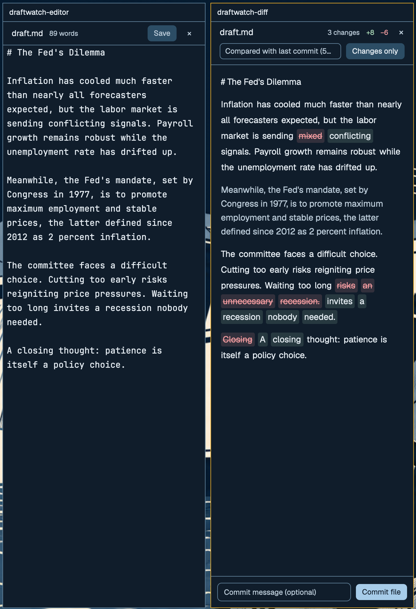

# Draftwatch for Herdr

Two panes that open beside a coding agent so a writer can see, word by word, what the agent changed in a text file: an editor for the file, and a live word diff against a git version. Click a changed word to put the old wording back or to send the agent a note about it.

**What you see:**

Two mod panes, opened to the right of the terminal that asked for them. Both use the theme's `background` and `foreground`, 14px prose, and a 1px `border` line under their headers.

- *Editor pane* (`draftwatch-editor`). A 38px header: the file name in semibold, a dim word count, a status on the right ("Unsaved changes" in the `blocked` color, else "Saved" or "Reloaded from disk" in `dim`), a **Save** button (solid when there is something to save, flat and dim otherwise) and a small × that closes the pane. Under it, Herdr's `Editor`: soft-wrapped, no line numbers, no folding, the person's terminal font at 14px. When the file changes on disk under unsaved typing, a `raised` banner appears between header and editor: "This file changed on disk while you had unsaved edits." with **Load disk version** and **Keep my edits**.
- *Word-diff pane* (`draftwatch-diff`). A two-row header so it survives a narrow pane. Row one (34px): file name in semibold, then "N changes" in `dim`, "+A" in `ansi2`, "−D" in `ansi1` (words added and removed), and ×. Row two (36px): a bordered button reading "Compared with last commit (abc1234) ▾" that takes the remaining width, and a **Changes only** / **Show full text** button. Below, the document, 16px padding, 4px between lines:
  - an unchanged line is one wrapped block in `muted` (a line starting with `#` is semibold `foreground`);
  - a line with changes is laid out one word per element so it wraps: unchanged words plain, added words on an `ansi2` tint (26 alpha) with 3px corners, removed words in `ansi1` with a strikethrough on an `ansi1` tint;
  - a line that is entirely one added or removed run is a single tinted block;
  - an empty line is a 6px gap; with **Changes only**, runs of unchanged lines collapse to "⋯ N unchanged" in `dim` 11px.
  At the bottom, always: a commit-message input and a solid **Commit file** button, over a top border.
- *Version list.* Clicking the "Compared with…" button drops a list (max 220px, `surface`) between header and document: "Compare the file against", then **Mark this point (show only what changes from now)** in `accent`, then "Since my last prompt (HH:MM)" if a checkpoint exists, "Last commit (sha)", "Last push (origin/main sha, when)" if the branch has one, and every earlier commit that touched the file. The current choice has the `selected` background.
- *Selected change.* Clicking a changed word gives every word of that change an `accent` border and a stronger tint, and shows a bar above the commit row: the old wording struck through in `ansi1`, the new in `ansi2`, then **Keep** and a solid **Revert this change**. If an agent opened the panes, a second row: a note input ("Note to the agent about this change") and **Send note to t7** (the agent's terminal).

**How it behaves:**

- The diff redraws within a second or two of any save to the file, whoever made it. It also re-checks every 15 seconds, which is how it notices a commit. An unchanged check does not redraw the window.
- **Revert this change** rewrites the file on disk with that one change put back to the compared version's wording. It refuses, and says so, if the file changed in the meantime.
- **Send note** pastes four lines into the agent's terminal and submits them: `Draftwatch review note on <file>`, `Change: "old" became "new"`, `In the line: …`, `My note: …`. Enter in the note box sends too.
- **Commit file** commits only this file as saved on disk, with the typed message or "Update <file>", then compares against the new commit.
- **Mark this point** saves a private copy of the file outside git and compares against it. With the optional prompt hook, the same thing happens each time the person sends Claude Code a prompt.
- The editor saves with Cmd+S or **Save**. It never overwrites a version it has not read. When the file changes on disk and there is no unsaved typing, it reloads.
- Right-click anywhere in either pane opens Herdr's own pane menu (Split right, Split down, Zoom, Close pane). Escape leaves the commit box, the note box and the version list.
- The chosen comparison is remembered per file, per pane copy, and falls back to the last commit with a note if it no longer exists.
- Agent status is not shown; these panes follow a file, not an agent.

**Built from:**

- Two mods, `draftwatch-editor` and `draftwatch-diff`, both `{ "place": "none" }`. They only appear when opened as panes: `pane.split {direction: "right", mod, props: {file, agent?}}`, the editor first, then the diff split off the editor's pane. `file` is an absolute path; `agent` is the terminal address of whoever opened them.
- `draftwatch-diff/bridge.py` (Python 3.9+, standard library only) does the work the pane cannot: `diff <file> --base head|push|checkpoint|<sha>` prints JSON `{file, name, repo, baseline: {kind, id, label}, segments, hunks}`; `baselines`, `revert <file> <id> --base …`, `checkpoint <file>`, `commit <file> -m …`; and `open <file>`, which runs the two splits, using `HC_TERMINAL_ID` to find the caller's pane with `herdr-app ls`. The pane runs it with `exec("python3", [appHome() + "/mods/draftwatch-diff/bridge.py", …])`.
- `draftwatch-diff/engine.py` is Draftwatch's diff engine, copied verbatim from https://github.com/mtkonczal/Draftwatch by `tools/sync_engine.py`: `git diff -U1000000 --no-color --word-diff=porcelain`, a parser that turns it into `context` / `add` / `del` / `newline` segments, content-addressed change ids (so an id survives edits elsewhere in the file), and a reconstruction that rebuilds the file with chosen changes rejected.
- `herdr` functions: `exec`, `hc` (for `hc send`), `appHome`, `watchFolder` (on the file's folder), `readTextFile`, `writeTextFile` (with the expected text, so a stale save is refused), `panes`, `spaces`, `run("pane.close")`, `openOverlay({mod: "menu", kind: "popup", props: {tab: "pane", target: {pane}}})`, `theme`, `settings`, `props`. From gpui-base: `Editor`, `EditorState`, `Input`, `InputState`, `Scrollbar`.
- Programs it runs: `python3`, `git`, `hc`. It reads and writes the one file it was opened on, reads that file's git repository, and keeps checkpoint copies in `~/.cache/draftwatch/checkpoints/`. No network.
- Optional, outside the mods folder and only when asked for: `bridge.py install-skill` writes a `draftwatch-herdr` skill to `~/.claude/skills` and `~/.agents/skills`; `bridge.py install-hook` adds a `UserPromptSubmit` hook to `~/.claude/settings.json` (backup kept).

**Watch out:**

- A mod pane is not told its own pane id and cannot set its header title, which shows the mod's name. Each pane finds itself among `panes()` by mod name (the only one, else the focused one, else the one in the shown tab), so two Draftwatch pairs in one tab can act on each other's pane. The file name is drawn inside the pane instead.
- If the folder `draftwatch-diff` is renamed, change `NAME` at the top of its `main.js`: it is how the pane finds `bridge.py` and itself.
- Inline styled text does not exist in a mod, so a changed line is one element per word in a wrapping flex row. Unchanged lines stay single blocks to keep long documents cheap. Drawing stops at 1,500 lines with a note.
- A `v_virtual_list` or `list` cannot hold click handlers, which is why the document is a plain scroll area.
- Word diffs ignore whitespace, so reverting an inserted word can leave a double space. This is the engine's documented behavior, shared with the Draftwatch app.
- `bridge.py` must not leave a `__pycache__` in the mod folder (Herdr reloads a mod when its folder changes); it sets `sys.dont_write_bytecode`.
- A diff label with a relative date ("2 minutes ago") changes every minute and would redraw the window on every poll; diff labels carry none.
- Commit takes what is on disk. Unsaved typing in the editor pane is not included, and nothing warns about it yet. Closing the editor pane with unsaved typing drops it.
- The editor shows plain text; this Herdr version did not highlight Markdown.
- Built and tested with herdr-app 0.1.15 on macOS.

**Done when:**

- `herdr-app check` passes for both mod folders and `herdr-app status` lists no errors.
- `python3 tests/test_bridge.py` passes (it needs only git and Python).
- `python3 bridge.py open <a file in a git repo with uncommitted edits>` from a Herdr terminal opens the editor and the diff to the right of that terminal, and the diff shows the edits word by word.
- Saving a change to the file from outside updates both panes within two seconds.
- Clicking a changed word and **Revert this change** restores the old wording on disk.
- With an agent's terminal as `agent`, **Send note** makes the four-line note arrive in that terminal.
- **Mark this point**, then one more edit, shows only that edit.
- **Commit file** leaves "No changes against the baseline."
